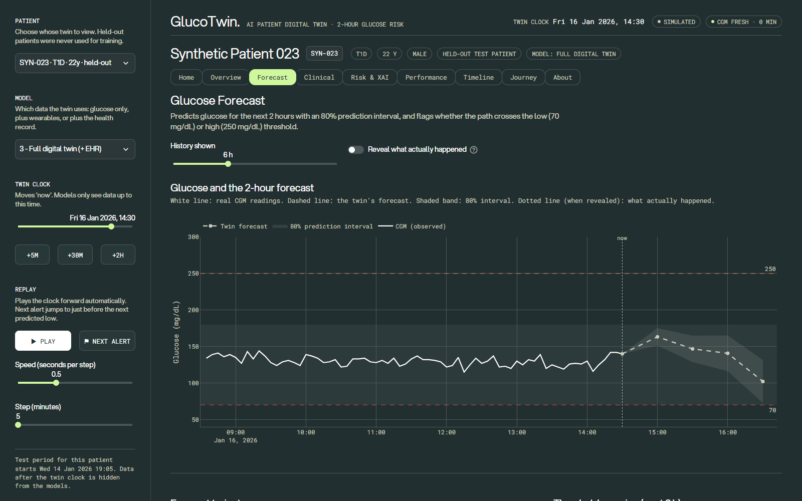
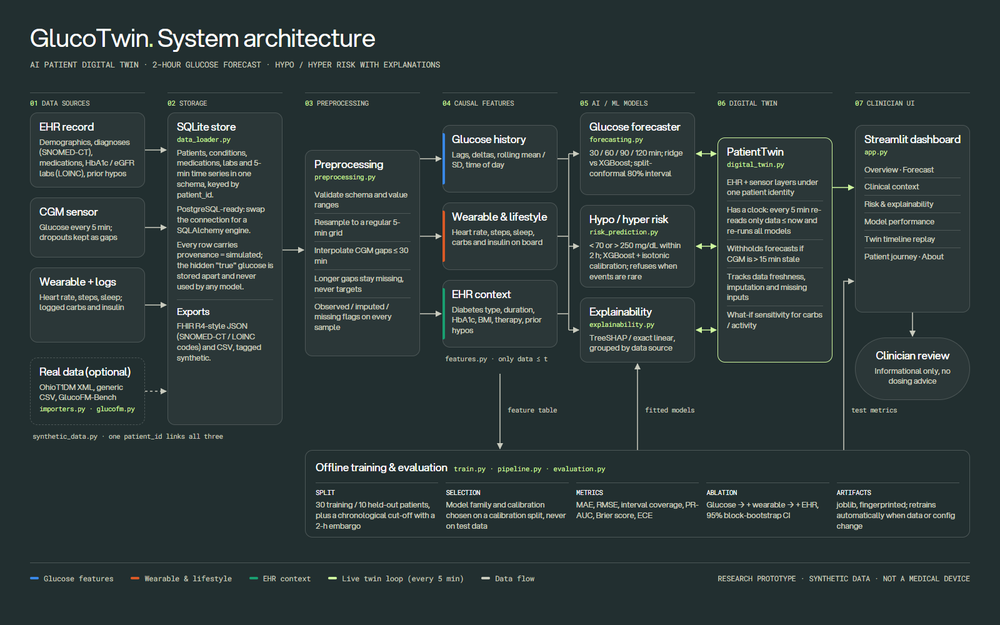

# GlucoTwin — an AI patient digital twin for 2-hour glucose risk

> **Research and educational prototype built on synthetic data.** It is not a medical device, it has not been
> clinically validated, and it never gives treatment or insulin-dosing advice.



## Submission checklist

| Item | Where |
|---|---|
| Team details | [Team](#team-details) |
| College / incubator | [SRM University](#college--incubator) |
| Project title | [GlucoTwin](#project-title) |
| Problem statement | [Problem statement](#problem-statement) |
| Healthcare use case | [Healthcare use case](#healthcare-use-case) |
| Technical stack | [Technical stack](#technical-stack) |
| AI/ML model and framework details | [AI/ML models](#aiml-model-and-framework-details) |
| Demo video (15–20 min, unlisted YouTube) | [Demo video](#demo-video) |
| Open-source license | [MIT](#open-source-license) · [LICENSE](LICENSE) |
| Architecture diagram (PDF) | [docs/GlucoTwin_Architecture.pdf](docs/GlucoTwin_Architecture.pdf) |
| Presentation (PDF) | [docs/GlucoTwin_Presentation.pdf](docs/GlucoTwin_Presentation.pdf) |
| Public access | This repository is public. Every file above is in the repo, and the video is an unlisted (link-only) YouTube video, so no extra permissions are needed. |

---

## Team details

| Name | Role |
|---|---|
| **Daksh Kumar** | Team leader |
| Shikhar Kulshrestha | Team member |
| Riya Rastogi | Team member |

## College / incubator

**SRM University**

## Project title

**GlucoTwin: an AI patient digital twin for 2-hour glucose risk prediction**

## Problem statement

People with diabetes spend hours each day outside the target glucose range. Dangerous lows and highs are often
visible in the data **before** they happen, but that data is split across systems:

* the **electronic health record (EHR)** holds who the patient is: diabetes type, HbA1c, medications and history of
  hypoglycaemia;
* the **continuous glucose monitor (CGM) and wearable** hold what is happening right now: the glucose trend, heart
  rate, activity, sleep, meals and insulin.

Clinicians rarely see both together, and most CGM alerts react to the current value instead of anticipating the next
two hours.

**Our question:** can a patient digital twin that fuses static EHR context with live sensor streams forecast glucose
2 hours ahead, flag threshold crossings, and show whether each data source actually helps?

## Healthcare use case

**Decision support for diabetes care teams who monitor patients on CGM.**

* **Users:** endocrinologists, diabetes nurses and remote-monitoring teams caring for people with type 1 or type 2
  diabetes.
* **Workflow:**
  1. Sensor data arrives every 5 minutes.
  2. The patient's twin updates its state.
  3. The forecast, risk and their reasons appear on one screen.
  4. The clinician reviews them.
* **Value:**
  * earlier warning of hypoglycaemia (< 70 mg/dL) and hyperglycaemia (> 250 mg/dL);
  * EHR and sensor context in one view;
  * uncertainty that is always shown;
  * explanations a clinician can check before acting.
* **Example from the demo:** held-out patient SYN-023 (type 1, 22 years old).
  * Glucose is 140 mg/dL and still rising after a meal, yet the twin forecasts about 102 mg/dL in 2 hours and rates
    the hypo risk as *Elevated (21%)*.
  * The top drivers are the insulin logged in the last 2 hours and the insulin still on board.
  * A trend-only alarm would miss this.
* **Safety:** the output is informational only. GlucoTwin never recommends treatment or insulin doses.

## Technical stack

| Layer | Technology |
|---|---|
| Language | Python 3.10+ (tested on Python 3.14, Windows 11) |
| Data | pandas, NumPy, SciPy; SQLite (PostgreSQL-ready schema); FHIR R4-style JSON and CSV export |
| Machine learning | XGBoost, scikit-learn (ridge regression, isotonic calibration, HistGradientBoosting fallback) |
| Explainability | TreeSHAP via XGBoost `pred_contribs`; exact linear contributions for ridge |
| App | Streamlit dashboard, Plotly charts, custom HTML components (home page, patient journey) |
| Quality | pytest: 30 tests covering causality, leakage, splits, missing data and twin behaviour |
| External data (optional) | Importers for OhioT1DM XML and generic CSV; GlucoFM-Bench via Hugging Face `datasets` and `pyarrow` |

Everything runs offline on a laptop, with no paid APIs and no cloud. Generating the data takes about 6 s, full
training about 30 s, and one twin update about 0.3 s.

## AI/ML model and framework details

| Component | Choice | Why |
|---|---|---|
| Forecast target | Observed CGM at 30 / 60 / 90 / 120 min ahead; one direct model per horizon, predicting the change from now | No error compounding; imputed values are never targets |
| Model families | Ridge regression vs XGBoost gradient boosting, chosen by **calibration-set** MAE | Simple first; add complexity only if it helps |
| Feature sets | ① glucose only, ② + wearable and lifestyle, ③ + EHR (full twin), compared against a persistence baseline | Measures what each data source adds |
| Uncertainty | Split-conformal 80% prediction intervals | Distribution-free; test coverage is reported |
| Risk | Any new crossing of < 70 or > 250 mg/dL in the next 2 h; XGBoost + isotonic calibration; alert threshold set to the F1 maximum on the calibration split | Calibrated probabilities, never tuned on test data |
| Refusal | Fewer than 30 training (or 10 calibration) events → no probability shown | No invented probabilities |
| Explanations | TreeSHAP per prediction, grouped by data source (glucose / wearable / EHR) | Labelled as associations, not causes |
| Digital twin | `PatientTwin`: holds the EHR and sensor layers under one ID, has a clock, re-reads only data ≤ now on every update, and withholds forecasts if the CGM is > 15 min stale | A stateful, patient-specific twin, not a static model |

**Evaluation design:**
* 30 training and 10 held-out patients.
* A chronological cut-off with a 2-hour embargo.
* Preprocessing is fitted on training data only.
* Ablation significance comes from a block bootstrap over patient-days.

### Results (synthetic data, seed 42, held-out patients)

| Configuration | 2-h MAE (mg/dL) | RMSE | 80% interval coverage |
|---|---|---|---|
| Persistence (last value) | 31.85 | 42.67 | — |
| Glucose only (XGBoost) | 22.22 | 31.76 | 0.80 |
| + Wearable (XGBoost) | 20.79 | 29.23 | 0.77 |
| **Full twin + EHR (XGBoost)** | **20.56** | **29.04** | 0.76 |

* The full twin reduces 2-hour error by **35%** compared with persistence.
* Wearable signals give a significant further gain: −1.43 mg/dL, 95% CI [−2.15, −0.66].
* EHR context on top of wearable data showed **no clear difference** (−0.23, CI [−0.79, 0.28]), and we report that
  honestly.
* For risk, PR-AUC is 0.50–0.53 for highs (base rate 7.6%) and 0.31–0.46 for lows (base rate 1.1%).

These are synthetic results that show the pipeline works. They are **not** clinical evidence. The full method and
limitations are in [glucotwin/README.md](glucotwin/README.md).

## Demo video

**▶ Demo video (unlisted YouTube): _link coming soon_**

<!-- Replace the line above with: **▶ [Watch the demo on YouTube](https://youtu.be/XXXXXXXXXXX)** -->

## Architecture diagram

PDF: [docs/GlucoTwin_Architecture.pdf](docs/GlucoTwin_Architecture.pdf)



## Presentation

PDF (16 slides covering the problem, use case, architecture, stack, models, evaluation, results, demo, limitations
and next steps): [docs/GlucoTwin_Presentation.pdf](docs/GlucoTwin_Presentation.pdf)

## Run it

```powershell
git clone https://github.com/DakshKumar05/GlucoTwin.git
cd glucotwin\glucotwin
python -m venv .venv
.venv\Scripts\activate
pip install -r requirements.txt

python train.py --regenerate     # optional (~1 min): generates synthetic data, trains models, prints evaluation
streamlit run app.py             # opens http://localhost:8501
pytest -q                        # 30 tests
```

If no trained models exist, the dashboard generates the data and trains on first launch. Nothing needs to be
downloaded.

## Repository layout

| Path | Contents |
|---|---|
| [glucotwin/](glucotwin/) | The application: `app.py` (Streamlit dashboard), `src/` (data, features, models, twin), `tests/`, `train.py`, plus the detailed [technical README](glucotwin/README.md) |
| [glucotwin/docs/PRESENTATION.md](glucotwin/docs/PRESENTATION.md) | Pitch notes, Mermaid diagrams, demo script and judge Q&A |
| [docs/](docs/) | Submission material: architecture diagram and presentation (PDF), dashboard screenshots, and the HTML sources they were rendered from |
| [demo/](demo/) | Patient-journey page embedded in the dashboard |
| [design/](design/), [styles/](styles/), [fonts/](fonts/) | Design tokens, theme and the Aspekta font |

## Open-source license

GlucoTwin is released under the **[MIT License](LICENSE)**. You may use, modify and redistribute it, including
commercially, as long as the copyright notice is kept.

Third-party material keeps its own license:
* The Aspekta and Roboto Mono fonts are under the SIL Open Font License; see the `*-OFL.txt` files.
* The optional GlucoFM-Bench dataset is **not** included in this repository. It is CC BY-NC-SA 4.0 (non-commercial)
  and is downloaded separately.
