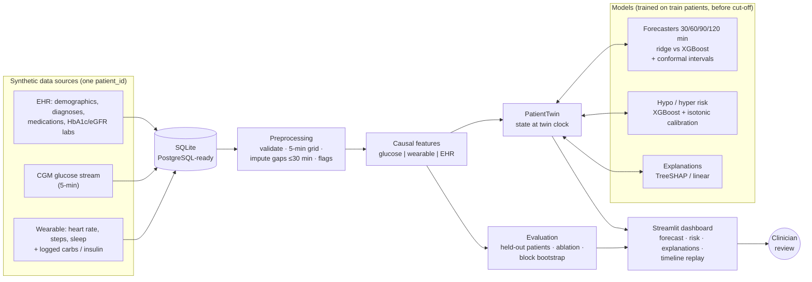
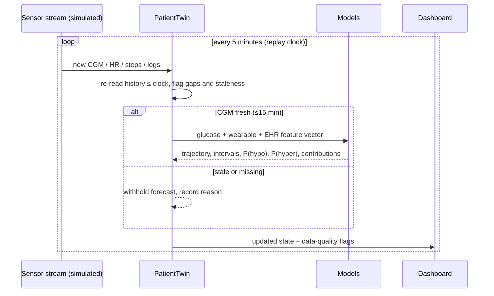

# GlucoTwin — Hackathon Presentation Pack

## 1. Problem statement
People with diabetes spend hours a day outside the target glucose range. Dangerous lows and highs are often
visible in the data **before** they happen, but that data is split across systems:
* the EHR holds who the patient is (diabetes type, HbA1c, medications, hypo history),
* the CGM and wearable hold what is happening right now (glucose trend, activity, sleep, meals).

Clinicians rarely see both together, and most CGM alerts react to the current value instead of anticipating the
next two hours.

**Question:** can a patient digital twin that fuses static EHR context with live sensor streams forecast glucose
2 hours ahead and flag threshold crossings, and does each data source actually help?

## 2. Solution and differentiators
**GlucoTwin** is a stateful virtual patient that updates every 5 minutes. It shows a 2-hour forecast with
uncertainty, calibrated low/high risk, and an explanation of each prediction in a doctor-facing dashboard.

| Differentiator | What we actually built |
|---|---|
| A real twin, not a static chart | `PatientTwin` re-reads only data up to its clock and recomputes features and every model at each update. A replay shows it evolve live |
| Measured, not assumed, value of data fusion | Three-way ablation (glucose → + wearable → + EHR) with block-bootstrap confidence intervals |
| Scientific hygiene | Held-out *patients* **and** a chronological cut-off with embargo; model selection and calibration never touch test data |
| Honest uncertainty | Conformal prediction intervals with test coverage reported; risk models refuse to output probabilities when events are too rare |
| Safety by design | Withholds forecasts on stale CGM; labels observed / imputed / simulated data; review prompts are informational only; no dosing advice |
| Interoperability-ready | SQLite → PostgreSQL path; FHIR R4-style export with SNOMED-CT / LOINC codes where known |

## 3. Architecture

### Data and model workflow

## 4. Innovation and feasibility
* **Innovation:** We treat the twin as a living object with a clock, data-quality state and calibrated
  uncertainty. We make the claim "fusion helps" testable through ablation.
* **Grounding:** The healthcare digital-twin literature (e.g. Khoshfekr Rudsari et al., *Digital twins in
  healthcare: a comprehensive review and future directions*, Front. Digit. Health 2025, doi:10.3389/fdgth.2025.1633539)
  frames DTs as a physical entity plus a virtual model plus two-way information flow, built by integrating EHR and
  IoT data. The same review highlights data quality, interoperability, validation, privacy and equity as open
  challenges. Each of those maps to a concrete design decision here.
* **Feasibility:** Pure Python on a laptop. Data generation takes about 6 s, full training about 25 s, and a twin
  update about 0.3 s. There are no paid APIs and no cloud dependency. XGBoost is optional (automatic fallback).
* **Path to real data:** The loader accepts any `patient_id, timestamp, glucose_mgdl (+ optional signals)` table.
  The next step would be OhioT1DM under its data-use agreement, or a clinical partner's de-identified data, with
  per-patient linkage that genuinely exists.

## 5. Risks, limitations and mitigations

| Risk / limitation | Mitigation in this prototype | What would be needed next |
|---|---|---|
| Synthetic data; the simulator encodes our assumptions | Every assumption is listed in-app; results are framed as a pipeline demonstration | External validation on real CGM + EHR data |
| Data leakage inflating results | Patient-level + chronological split, 2-h embargo, train-only preprocessing, causality tests | Prospective / temporal validation |
| Rare hypo events → unstable risk estimates | Minimum-event rules; refuse to show probabilities; report base rates and PR-AUC | Larger cohorts; event-level metrics |
| Static EHR features memorise patients | Held-out-patient evaluation exposes it (EHR gain not significant) | More patients; regularisation; mixed-effects models |
| Over-trust in explanations | Labelled as associations; method named on screen | Clinician user studies |
| Missing / stale sensor data | Explicit flags; gaps > 30 min never imputed; forecast withheld if CGM > 15 min old | Device-level quality signals |
| Privacy | Synthetic only; FHIR export tagged synthetic | De-identification, access control, federated learning |
| Bias / equity | Not assessable with 40 synthetic patients, and we say so | Subgroup audits on representative data |
| Regulatory | Positioned as research only; no dosing advice | Verification and validation following frameworks such as ASME V&V 40; regulatory review |

## 6. Reproducible demo scenario (seed 42)

Setup before presenting: run `python train.py` once, then `streamlit run app.py`.

1. **Load a synthetic patient.** The app opens on held-out patient **SYN-023** (T1D, 22 y) at 07:00 on the first
   day after the train/test cut-off. Point out the **SIMULATED** badge and "held-out test patient" in the header.
2. **Show the EHR and wearable data combined.** Open **Clinical Context**: diagnoses with SNOMED codes, insulin
   therapy, HbA1c history on the left, and the last 24 h of heart rate, steps, sleep, carbs and insulin on the right.
   Read the "How the twin fuses…" panel.
3. **Generate a forecast.** Open **Glucose Forecast**: observed vs imputed CGM, a dashed 2-h trajectory and the 80%
   band.
4. **Flag a future risk.** Click **⚑ Next alert** in the sidebar. The clock jumps to just before the model's next
   low-glucose alert (Fri 16 Jan, 14:40). Glucose is 147 mg/dL and still *rising* after a logged 40 g meal, yet the
   twin forecasts about 99 mg/dL in 2 h, and the hypo card shows *Elevated (~22%)*. Open **Risk & Explainability**:
   the top drivers are the 10.5 U of insulin logged 30 min earlier and the insulin still on board, plus an EHR feature
   (years since diagnosis). The twin is looking past the current upward trend.
5. **Watch the twin update.** Open **Twin Timeline** and press **▶ Play**. Glucose falls towards 70. In our run,
   glucose fell from 147 to 80 mg/dL and the hypo probability climbed from 22% to 72% (High) over 85 minutes, and the past forecasts are
   plotted against what really happened. Press **Pause**, then toggle **Reveal what actually happened** on
   Glucose Forecast.
6. **Show the evaluation.** Open **Model Performance**: the configuration comparison table, the ablation chart with
   confidence intervals, and the calibration curve. End on the synthetic-data warning.

## 7. Two-minute live demo script

> **0:00 – Problem (15 s).** "Glucose crises are often predictable, but the information to predict them is
> split between the EHR and the sensors. We built GlucoTwin, a digital twin that fuses both and looks two hours
> ahead. Everything you'll see is synthetic data."
>
> **0:15 – The twin (25 s).** *(Overview → Clinical Context)* "This is held-out patient SYN-023, never seen in
> training. The left side is the EHR layer: type 1, insulin, HbA1c trend. The right side is the live layer: heart
> rate, steps, sleep, meals. Both share one patient ID, and the twin combines them into a single state every five
> minutes."
>
> **0:40 – Forecast and risk (30 s).** *(Next alert → Glucose Forecast → Risk)* "I'll jump to the next moment the
> model raises an alert. Here's the two-hour forecast with an 80% conformal interval, and the hypo risk is
> elevated, even though glucose is still rising after lunch. Why? The top drivers are the 10.5 units of insulin
> logged 30 minutes ago and the insulin still on board, plus EHR context. A trend-only alarm would miss this. These
> are associations the model uses, not causes. The prompt underneath is for review only; we never suggest
> doses."
>
> **1:10 – Live update (25 s).** *(Twin Timeline → Play)* "Now I'll stream new observations. Each tick the twin
> re-reads its history and re-runs every model. Watch glucose fall and the hypo probability climb, and these
> purple dots are what the twin predicted two hours earlier, plotted against what actually happened."
>
> **1:35 – Evidence (25 s).** *(Model Performance)* "We test on unseen patients after a time cut-off. The learned
> model beats persistence by about 10 mg/dL, wearable data adds a significant further gain, but adding EHR on top
> was *not* significant in our data, and we report that honestly. Synthetic results show the pipeline works. Real
> validation is the next step."

## 8. Likely judge questions

**Q: Isn't this just a forecasting model with a dashboard?**
A: The twin is a stateful, patient-specific object. It holds the EHR layer and the live layer under one identity,
has a clock, re-derives its state from the data available at that time (a test verifies there is no look-ahead),
tracks data freshness, and withholds outputs when inputs are stale. The replay shows it evolve. What we don't have
is a mechanistic physiology model; ours is a statistical twin, and we say so.

**Q: Your data is synthetic. Why should we believe the results?**
A: You shouldn't treat them as clinical evidence, and we don't claim they are. The synthetic data lets us
demonstrate an end-to-end, leakage-free pipeline without restricted data. The evaluation code is
dataset-agnostic: `python import_data.py --format ohio|csv --input ...` followed by `python train.py --source real`
retrains everything on real data (OhioT1DM under its data-use agreement, or partner data) with no code changes.

**Q: Did the EHR actually help?**
A: Compared with glucose alone, the full twin was significantly better (−1.8 mg/dL MAE, CI excluding zero). Most
of that came from wearable signals. EHR on top of wearable data was not significant (−0.5 mg/dL, CI −1.18 to
+0.11). With only 30 training patients, static features are hard to learn from and can even memorise patients;
the hypo classifier got slightly worse with EHR. Testing on larger, real cohorts is the most important next step.

**Q: How do you prevent data leakage?**
A: Four layers:
* test patients are never used for training, model selection or calibration;
* a chronological cut-off with a 2-hour embargo;
* imputers, scalers and calibrators are fitted on training data only;
* tests assert no patient overlap, the embargo, causal features, and targets that never cross patients.

**Q: How are the probabilities calibrated, and how good are they?**
A: Isotonic regression on a calibration split from training patients after the cut-off. We report Brier score,
ECE and a reliability curve on test patients. If there are fewer than 30 positive training windows, the model
refuses to output a probability.

**Q: Why 2-hour MAE around 20 mg/dL? Is that good?**
A: It's measured on held-out synthetic patients. Persistence gets about 32, so the model removes about a third of
the error. Comparisons with published real-data benchmarks would be misleading, because the data differ.

**Q: How do you handle missing data?**
A: Explicitly:
* CGM gaps of 30 minutes or less are linearly interpolated and flagged;
* longer gaps stay missing and are never targets;
* missing steps are not assumed to be zero;
* XGBoost handles missing inputs natively, and ridge uses train-fitted median imputation plus missingness
  indicators;
* the twin withholds forecasts when the CGM is over 15 minutes stale and lists missing inputs on screen.

**Q: What about clinical safety and regulation?**
A: It's a research prototype: no dosing or treatment advice, informational prompts only, uncertainty always shown.
A real product would need verification and validation (for example following ASME V&V 40-style credibility
assessment), prospective studies, privacy controls, and regulatory review.

**Q: Explainability: can a clinician trust SHAP values?**
A: They show how the model weighted the inputs for this prediction, not what caused the glucose change. We label
them that way, group them by data source, and pair them with uncertainty and data-quality warnings.

**Q: How would this scale?**
A: Feature computation is incremental and per patient (about 0.3 s per update on a laptop). The SQLite schema moves
to PostgreSQL unchanged. Streaming ingestion (e.g. MQTT/Kafka), FHIR-native EHR access and federated training are
natural extensions.

**Q: What would you do with another month?**
A: Validate on real CGM data, add subgroup and fairness audits, try a hybrid mechanistic + ML twin, add event-level
alert metrics (lead time, false alerts per day), and run a usability session with clinicians.
